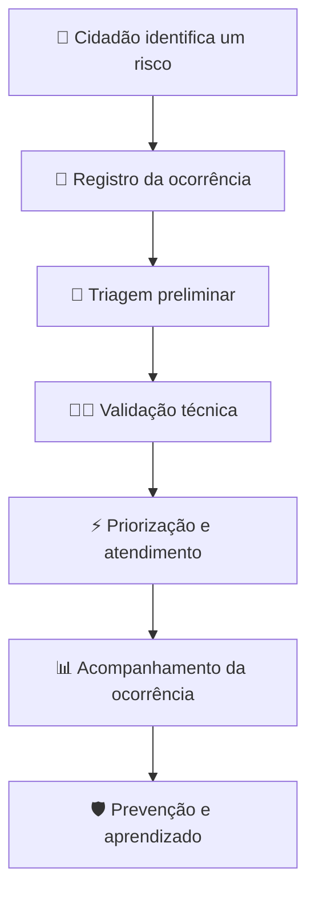

# ⚡ VIGIA — Rede Segura

### Plataforma Inteligente de Vigilância Colaborativa da Rede Elétrica

<p align="center">
  <strong>Conectando cidadãos, tecnologia e especialistas para identificar riscos e prevenir acidentes na rede elétrica.</strong>
</p>

<p align="center">
  
  
  
  
</p>

---

## 📌 Sobre o projeto

O **VIGIA — Rede Segura** é um protótipo de uma plataforma digital de vigilância colaborativa voltada à identificação, classificação e acompanhamento de ocorrências na rede elétrica.

A proposta é conectar três agentes principais:

- **População:** registra ocorrências e compartilha informações sobre situações potencialmente perigosas.
- **Inteligência artificial:** auxilia na triagem e na classificação preliminar dos riscos.
- **Especialistas técnicos:** analisam as ocorrências, validam as informações e acompanham as ações de atendimento.

A solução busca contribuir para a prevenção de acidentes, a melhoria da eficiência operacional e a transparência na gestão de riscos elétricos.

O projeto foi desenvolvido como um MVP para demonstrar a experiência de utilização e o fluxo operacional da solução.

## 🎯 Problema e solução

Problemas na infraestrutura elétrica, como cabos rompidos, postes danificados, ligações irregulares e transformadores com defeito, podem representar riscos significativos à população.

O VIGIA propõe um fluxo colaborativo para facilitar a comunicação dessas situações e organizar seu acompanhamento.

**Fluxo conceitual:**



## ✨ Funcionalidades implementadas

### 1. 🏠 Página inicial

Apresenta a proposta da plataforma e seus principais objetivos.

- Apresentação institucional do VIGIA.
- Indicadores demonstrativos de ocorrências e riscos prevenidos.
- Explicação visual do fluxo de funcionamento.
- Acesso rápido ao formulário de denúncia e ao painel técnico.
- Elementos visuais animados e interface responsiva.

### 2. 📸 Registro de denúncias

Permite que o cidadão registre situações potencialmente perigosas na rede elétrica.

**Categorias disponíveis:**

| Categoria | Descrição |
|---|---|
| Fio solto / caído | Cabos fora de posição ou próximos ao solo |
| Ligação irregular | Conexões elétricas não autorizadas |
| Poste danificado | Estruturas inclinadas ou comprometidas |
| Risco à vida | Situações com potencial de perigo imediato |
| Transformador | Problemas em transformadores |
| Árvore na rede | Vegetação em contato com a rede elétrica |
| Iluminação pública | Falhas na iluminação |
| Cabo partido | Condutores rompidos |

**Recursos disponíveis:**

- Seleção da categoria da ocorrência.
- Campo para descrição detalhada.
- Upload de fotografia com pré-visualização.
- Informação de localização demonstrativa.
- Opção de denúncia anônima.
- Validação dos campos obrigatórios.
- Geração de protocolo para a ocorrência registrada.

### 3. 🤖 Triagem preliminar simulada

Após o envio da denúncia, o sistema apresenta uma tela de processamento e gera uma avaliação preliminar.

O protótipo demonstra:

- Classificação da ocorrência.
- Sugestão de categoria.
- Nível de risco.
- Indicador de confiança.
- Descrição de possíveis elementos identificados.
- Verificação demonstrativa de duplicidade.

**Importante:** nesta versão, a classificação é produzida por regras locais em TypeScript, considerando a categoria selecionada e palavras-chave na descrição. Não existe integração com um modelo de inteligência artificial ou processamento real de imagens.

### 4. 🧑‍🔧 Painel técnico

Interface destinada à visualização e ao acompanhamento das ocorrências.

**Indicadores demonstrativos:**

- Ocorrências pendentes.
- Ocorrências em atendimento.
- Ocorrências resolvidas.
- Tempo médio de resposta.
- Distribuição dos registros por nível de risco.

**Quadro de acompanhamento:**

O painel organiza as ocorrências em quatro etapas:

1. Pendente de IA.
2. Validação técnica.
3. Em atendimento.
4. Resolvida.

Ao selecionar uma ocorrência, o usuário pode visualizar seus detalhes, consultar a avaliação preliminar e realizar ações de acompanhamento, como confirmar o atendimento ou rejeitar o registro.

### 5. 🗺️ Mapa de riscos

Apresenta as ocorrências em um mapa interativo utilizando Leaflet e OpenStreetMap.

**Recursos disponíveis:**

- Visualização geográfica das ocorrências.
- Marcadores diferenciados por nível de risco.
- Filtros por categoria.
- Filtros por classificação de risco.
- Filtros por situação da ocorrência.
- Informações adicionais ao selecionar um marcador.
- Alternância entre visão interna e visão pública demonstrativa.

### 6. 📊 Visualização de indicadores

O protótipo apresenta indicadores e gráficos para demonstrar como informações sobre as ocorrências podem auxiliar no acompanhamento operacional.

Os dados incluem distribuição de riscos, quantidade de registros por situação e indicadores gerais de desempenho.

---

## 🛠️ Tecnologias utilizadas

O projeto utiliza tecnologias modernas do ecossistema JavaScript e TypeScript.

| Tecnologia | Aplicação |
|---|---|
| React 18 | Construção da interface |
| TypeScript | Tipagem e organização do código |
| Vite | Ambiente de desenvolvimento e build |
| Tailwind CSS | Estilização responsiva |
| shadcn/ui | Componentes de interface |
| Radix UI | Componentes acessíveis |
| React Router DOM | Navegação entre páginas |
| Zustand | Gerenciamento de estado |
| TanStack React Query | Infraestrutura de gerenciamento de consultas |
| Framer Motion | Animações e transições |
| Leaflet | Mapas interativos |
| React Leaflet | Integração do Leaflet com React |
| Recharts | Visualização de gráficos |
| Lucide React | Ícones |
| Vitest | Infraestrutura de testes |
| ESLint | Análise estática e padronização |

## 🏗️ Arquitetura e organização

O projeto utiliza uma arquitetura organizada por páginas, componentes reutilizáveis, dados e gerenciamento de estado.

```text
vigia-rede-segura/
│
├── public/
│   ├── favicon.ico
│   ├── placeholder.svg
│   └── robots.txt
│
├── src/
│   │
│   ├── components/
│   │   ├── Navbar.tsx
│   │   ├── NavLink.tsx
│   │   └── ui/
│   │       └── Componentes reutilizáveis
│   │
│   ├── data/
│   │   ├── mockData.ts
│   │   ├── store.ts
│   │   └── types.ts
│   │
│   ├── hooks/
│   │   ├── use-mobile.tsx
│   │   └── use-toast.ts
│   │
│   ├── lib/
│   │   └── utils.ts
│   │
│   ├── pages/
│   │   ├── LandingPage.tsx
│   │   ├── DenunciaPage.tsx
│   │   ├── ResultadoPage.tsx
│   │   ├── PainelPage.tsx
│   │   ├── MapaPage.tsx
│   │   ├── Index.tsx
│   │   └── NotFound.tsx
│   │
│   ├── test/
│   │   ├── example.test.ts
│   │   └── setup.ts
│   │
│   ├── App.tsx
│   ├── main.tsx
│   ├── App.css
│   └── index.css
│
├── index.html
├── package.json
├── package-lock.json
├── tailwind.config.ts
├── tsconfig.json
├── vite.config.ts
└── vitest.config.ts
```

### Organização dos principais módulos

- `pages/`: páginas e funcionalidades principais da aplicação.
- `components/`: componentes compartilhados e elementos de interface.
- `data/`: modelos, dados demonstrativos e gerenciamento de estado.
- `hooks/`: hooks reutilizáveis.
- `lib/`: funções auxiliares.
- `test/`: configuração e exemplos de testes.

## 🔄 Gerenciamento de dados

O gerenciamento de estado é realizado com **Zustand**, por meio do arquivo `src/data/store.ts`.

O sistema mantém:

- Lista de ocorrências.
- Dados da última denúncia registrada.
- Informações de classificação preliminar.
- Atualização do status das ocorrências.

Os dados demonstrativos são definidos em `src/data/mockData.ts`, que gera 25 ocorrências distribuídas por cidades como João Pessoa, Campina Grande, Recife, Natal, Maceió, Aracaju e Teresina.

A aplicação utiliza dados locais e demonstrativos. Não há, nesta versão, persistência em banco de dados ou integração com uma API externa.

## 🚀 Como executar o projeto

### Pré-requisitos

Antes de começar, você precisará ter instalado:

- [Node.js](https://nodejs.org/) — versão compatível com Vite 5.
- npm — gerenciador de pacotes incluído com Node.js.
- Git.

### 1. Clone o repositório

```bash
git clone https://github.com/Gloterianota349/vigia-rede-segura.git
```

### 2. Entre na pasta do projeto

```bash
cd vigia-rede-segura
```

### 3. Instale as dependências

```bash
npm install
```

### 4. Execute o ambiente de desenvolvimento

```bash
npm run dev
```

O Vite disponibilizará o endereço local apresentado no terminal. Na configuração atual, a porta padrão é `8080`.

### 5. Gere a versão de produção

```bash
npm run build
```

### 6. Visualize a versão de produção localmente

```bash
npm run preview
```

## 🧪 Testes e qualidade de código

O projeto possui configuração para testes com Vitest e análise estática com ESLint.

**Executar os testes:**

```bash
npm run test
```

**Executar os testes em modo de observação:**

```bash
npm run test:watch
```

**Executar o ESLint:**

```bash
npm run lint
```

## ⚠️ Limitações atuais do protótipo

O VIGIA está em estágio de MVP demonstrativo. Algumas funcionalidades descritas na visão original ainda precisam ser desenvolvidas para que a plataforma possa operar em um ambiente real.

| Funcionalidade | Situação atual |
|---|---|
| Registro de denúncias | Implementado localmente |
| Upload e pré-visualização de fotos | Implementado |
| Denúncia anônima | Demonstrada na interface |
| Localização GPS | Simulada com coordenadas fixas |
| Triagem por inteligência artificial | Simulada por regras locais |
| Análise real de imagens | Não implementada |
| Detecção real de duplicatas | Não implementada |
| Validação técnica | Fluxo demonstrativo |
| Painel de acompanhamento | Implementado com dados locais |
| Mapa interativo | Implementado com dados demonstrativos |
| Banco de dados | Não integrado |
| Autenticação e controle de acesso | Não implementados |
| Notificações push ou SMS | Não implementadas |
| Integração com concessionárias | Não implementada |
| Relatórios estratégicos e preditivos | Ainda não implementados |

**Observação:** os indicadores exibidos na página inicial e no painel são demonstrativos, não representam estatísticas operacionais verificadas. As ações realizadas no protótipo não são persistidas após o encerramento da aplicação.

O sistema não deve ser utilizado como ferramenta de emergência ou como substituto dos canais oficiais de atendimento das concessionárias de energia.

## 🔭 Próximos passos

A evolução da plataforma pode contemplar:

- [ ] Integração com banco de dados para persistência das ocorrências.
- [ ] Autenticação e controle de acesso por perfil.
- [ ] Geolocalização real utilizando GPS do dispositivo.
- [ ] Integração com modelos de IA para análise de imagens e descrições.
- [ ] Detecção de ocorrências duplicadas por proximidade geográfica e similaridade.
- [ ] Fluxo completo de validação técnica e registro das decisões.
- [ ] Integração com APIs de concessionárias de energia.
- [ ] Notificações georreferenciadas para situações de risco.
- [ ] Painel analítico com indicadores históricos.
- [ ] Sistema de recomendação de ações preventivas.
- [ ] Simulador de efetividade de propostas operacionais.
- [ ] Testes automatizados das principais funcionalidades.

## 👨‍💻 Autor

**Guilherme Andrade**

- GitHub: [@Gloterianota349](https://github.com/Gloterianota349)

---

<p align="center">
  <strong>VIGIA — Tecnologia, colaboração e prevenção para uma rede elétrica mais segura. ⚡</strong>
</p>
